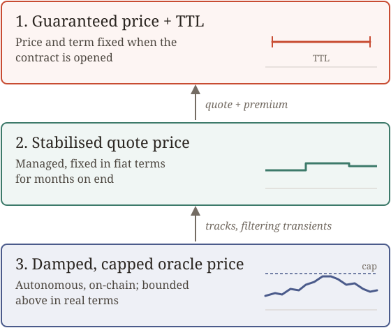
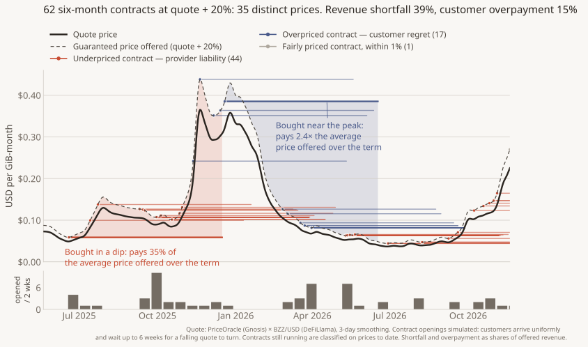
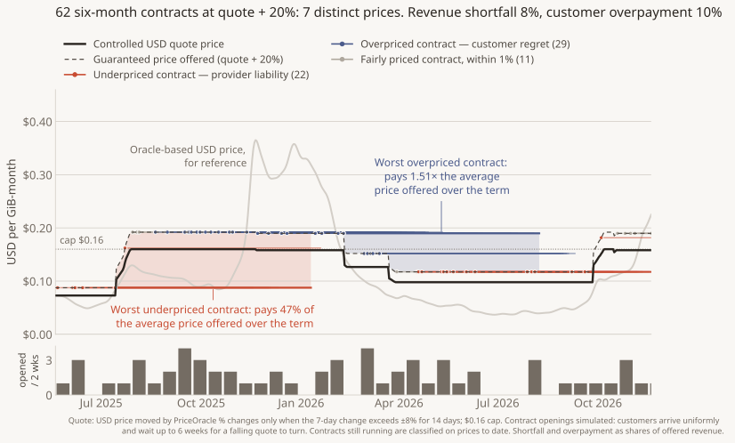

<!-- class: title -->

# How to build batches with guaranteed price and TTL

Andrew W. Macpherson

Shtuka Research

---

<!-- class: _ -->

I want to talk about the difference between stable prices and guaranteed prices in services, their impact on customers, and implementation challenges. 

I will also propose a realistic model of how these may be combined to provide a SaaS-like pricing experience.

---

## Suggested architecture

---

<!-- class: _ -->

## Stable prices and guaranteed prices

* A *guaranteed price + TTL* service is one where the price and TTL are fixed at the time the service is opened or extended, and this guarantee is underwritten by the provider (which may be the Swarm Network itself or a middleman).

* A *stable price* service is one where the price does not change much over time.

  For example:

  * Annual price drift is $\leq 0$, barring exceptional global market circumstances.
  * Price updates at most once per month.
  * Monthly price change is at most ~ drift between major fiat currencies.

---

Realistic services combine both models. Imagine a cloud SaaS:

What might a customer clicking on "Buy now" expect?

* *Guaranteed.* Pay quoted price up front, guaranteed one calendar month of service;
* *Stable.* Month-on-month price changes are infrequent (less than once per year) and small.

The SaaS will work to ensure these expectations are met.

<small>Foreign currency consumers of this service experience stable, but not constant, pricing from month to month. If both currencies are strong, the FX rate doesn't change that fast and this is usually fine.</small>

---

### Implementation challenges of this scheme

Suppose customer $A$ opens a contract at price $p$, and the price changes to $p'$ less than a month later.

* **Multiple contract types.** If new customers open contracts at $p'$ before a month has elapsed, the provider now has different customers paying different prices on his books, adding complexity.
* **Opportunity cost.** If $p'>p$, the provider pays an opportunity cost compared to the case customer $A$ paid the new price immediately.

These challenges are not very serious in this case because:

* If price changes less frequently than the maximum guaranteed contract length, there are at most two different contract types active at any one time.
* Per-customer price discrimination is time-limited to one month and size-limited in terms of the maximum realised price change.

---

### Customer experience challenges of this scheme

* **Regret.** If $p'<p$, the customer experiences regret.

* **Strategy sensitivity.** If the customer thinks the price is about to go down, he may choose to wait until the price change.

  This delays income. It's also more inconvenient for the customer if he has to think about this stuff.

These challenges are not serious in this case because:

* Regret or strategy sensitivity is time-limited to one month, infrequent, and size-limited in terms of the maximum allowed price change.

---

If the underlying quote price changes more frequently, in larger increments, or the TTL is much larger, these issues require active management. 

The baseline requirements for making this easy to implement are:

* **Stable quote price**
* **Modest cap on guaranteed TTL** 

It follows that *guaranteed prices are best built on top of stable prices.*

---

## Guaranteed prices built on Swarm's quote price

What if we push ahead and try to build guaranteed price+TTL batches on Swarm's current price oracle?

For concreteness, suppose the guaranteed price is oracle price + 20% (Callum's figure, taken out of context).

---

---

It's really hard to do this well:

* Instead of two contract types, now nearly every customer is on a completely unique contract.
* Customers know the quote price is changing, so they will try to wait until the price is low.
* You will sell more underpriced contracts than overpriced contracts, impacting your PnL.
* Customers who end up buying overpriced contracts anyway experience high regret.
* The problems all scale with the maximum guaranteed TTL.

---

The job will be much easier if you:

* Stabilise the underlying quote price
* Cap guaranteed TTL e.g. to one calendar month.

Build guaranteed price+TTL batches on top of a stable underlying oracle.

---

### What this could look like

**Question for the team:** Why don't we just make Swarm's price oracle quote look like this?
